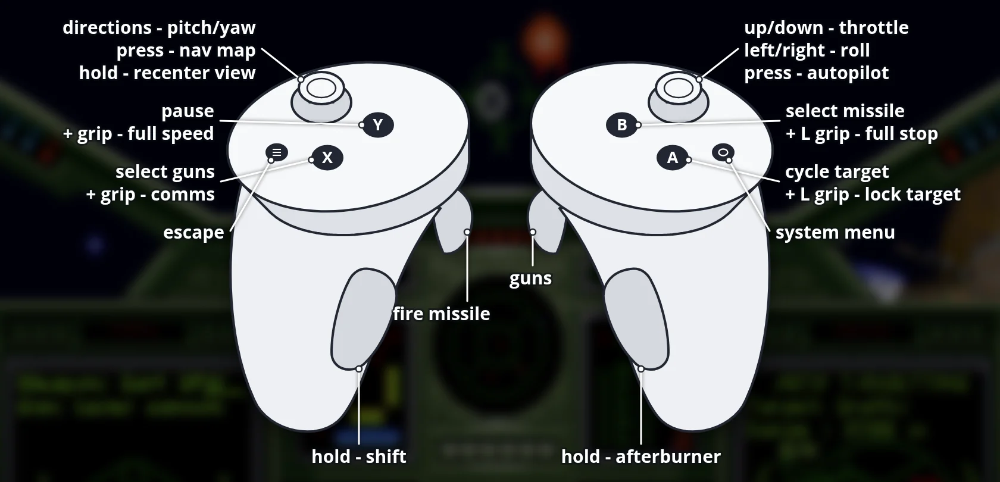

# Wing Commander VR (Meta Quest 3 and PICO) — 1.0.1

Standalone Quest build of the wc1-re reconstruction (SDL2 port of the 1990 DOS
original).  Space flight is in stereo 3D with head-look: ships are placed at
their real depth, stars sit at infinity, and the original cockpit art is wrapped
onto a 3D cockpit shell around you.  Menus, rooms and briefings appear on a big
floating screen with a laser pointer, there is a VR keyboard for names, and the
Touch controllers are the flight stick.

The game data is **not** included; you need your own copy of the DOS game
(GOG *Wing Commander*).

## Install

1. Install the APK (SideQuest, or):
   `adb install -r WingCommanderVR-1.0.1.apk`
2. Copy the game data. Use the GOG *Wing Commander* (DOS) installer and unpack
   it on the PC, e.g. `innoextract setup_wing_commander_1.0_(28045).exe`.
   Copy `WC.EXE` and the whole `GAMEDAT` folder to the headset:
   ```
   adb shell mkdir -p /sdcard/WingCommander/GAMEDAT
   adb push WC.EXE /sdcard/WingCommander/
   adb push GAMEDAT/. /sdcard/WingCommander/GAMEDAT/
   ```
3. Start *Wing Commander VR* from Library → Unknown Sources. On the very first
   start, allow "Access to all files" when asked (or:
   `adb shell appops set com.bilko.wc1vr MANAGE_EXTERNAL_STORAGE allow`).
   A red screen means the game data was not found.

### PICO (untested)

The same APK also runs on PICO 4 / Neo 3 (PICO OS 5.9.0 or
newer): the PICO controllers use the same button layout as the Touch
controllers below.  PICO support is new and not tested on PICO hardware yet.
Install with `adb install -r WingCommanderVR-1.0.1.apk` (or the PICO file manager), copy
the game data to `/sdcard/WingCommander` the same way, and allow storage access when
the app asks on the first start (it restarts by itself afterwards).

Saved games and pilot rosters are written to `/sdcard/WingCommander/GAMEDAT`
as in the DOS game.

## Controls



**Menus, rooms and briefings** (laser beam from the controller):

| Control | Action |
| --- | --- |
| Aim + trigger | Left click (either hand; the hand that pulls last aims) |
| Grip | Right click |
| A | Enter |
| B or Menu | Escape |
| Y / X | Answer "Y" / "N" |
| A / B in a "(Y/N)" prompt (load, save, quit) | Yes / No |
| Hold left stick click 1 s | Recentre the screen in front of you |

Text prompts (name, callsign, saved games) open a keyboard below the screen:
point and pull the trigger. Shift is on for the first letter and after a space.

**Flying:**

| Control | Action |
| --- | --- |
| Left stick | Pitch / yaw |
| Right stick left/right | Roll |
| Right stick up/down | Faster / slower |
| Right trigger | Guns |
| Left trigger | Fire missile |
| Right grip (hold) | Afterburner |
| A | Cycle target |
| B | Select missile |
| X | Select guns |
| Y | Pause |
| Menu | Escape |
| Left stick click | Navigation map |
| Right stick click | Autopilot |
| Left grip + A | Target lock |
| Left grip + B | Stop |
| Left grip + X | Communications (then left grip + Y/B to choose, A to send, X to close) |
| Left grip + Y | Full speed |

## Building

```
quest/tools/fetch_deps.sh                  # SDL2 2.32.10 source + Java glue
cd quest/android && ./gradlew assembleDebug
```
Needs the Android SDK (platform 34, build-tools 34, CMake 3.22.1), NDK
25.1.8937393 and JDK 17. Output: `app/build/outputs/apk/debug/app-debug.apk`.

`quest/tools/quest_run.sh` builds, installs, launches and pulls a headset
screenshot; `quest/tools/quest_cmd.sh` drives the game headless through the
developer command file `/sdcard/WingCommander/vrcmd` (`click X Y`, `move X Y`,
`key NAME`, `type TEXT`, `fake FIELD VALUE MS`, `wait`).

## Code map

* `src/quest/quest_xr.c` — OpenXR thread: EGL context, session, virtual
  screen quad, keyboard panel, laser beam, Touch sampling, haptics, recentre.
* `src/quest/quest_input.c` — game-side glue: data directory, logcat, virtual
  SDL gamepad for the port's 4button-4axis joystick mode, laser → mouse,
  keyboard → key events.
* `#ifdef WC1_QUEST` hooks in `src/sdl/{video,events,joystick,launcher,compat}.c`
  and `src/trainsim.c` (`ReadTextInput` shows the keyboard).
* `quest/CMakeLists.txt`, `quest/android/` — NDK/Gradle build.

## Stage 2: stereo space

In flight, space is rendered per eye: ships, missiles and dust are billboards at
their real 3D position, stars sit on a fixed sphere at infinity, and you can
look around with your head.  The cockpit art is a panel 0.9 m in front of you;
HUD pixels in the canopy window (reticle, target brackets) are on a panel at
8 m.  Tuning goes in `/sdcard/WingCommander/vr.cfg` (`world_scale=`,
`dash_distance=`, `hud_distance=`, `stretch=`, `stereo=0` to disable).

**3D cockpit:** the 2D cockpit art is projected from the pilot's eye onto a
curved shell, so it matches the original pixel for pixel from the default
head position. The console tilts down toward your lap (about 0.75 m to
0.45 m away), the canopy frame arches away overhead (about 1 m), and the sides
curve in. Where the window's bottom edge sits in each column decides what is
console and what is canopy, so this works for every ship's cockpit. Outside the
original art, the edges wrap around you and darken. `cockpit3d=0` brings back
the flat panel; `cockpit_wrap=0` disables the wrap-around. `dash_distance=`
scales the whole shell.

## Flight stick tuning

Pitch, yaw and roll go through a dead zone and an expo curve, for precise aim
near the centre while full deflection keeps the full turn rate. Defaults are
in `quest/vr.cfg.example` (copied to `/sdcard/WingCommander/vr.cfg`):
`stick_sensitivity=1.0`, `stick_expo=0.65`, `stick_deadzone=0.10`.
